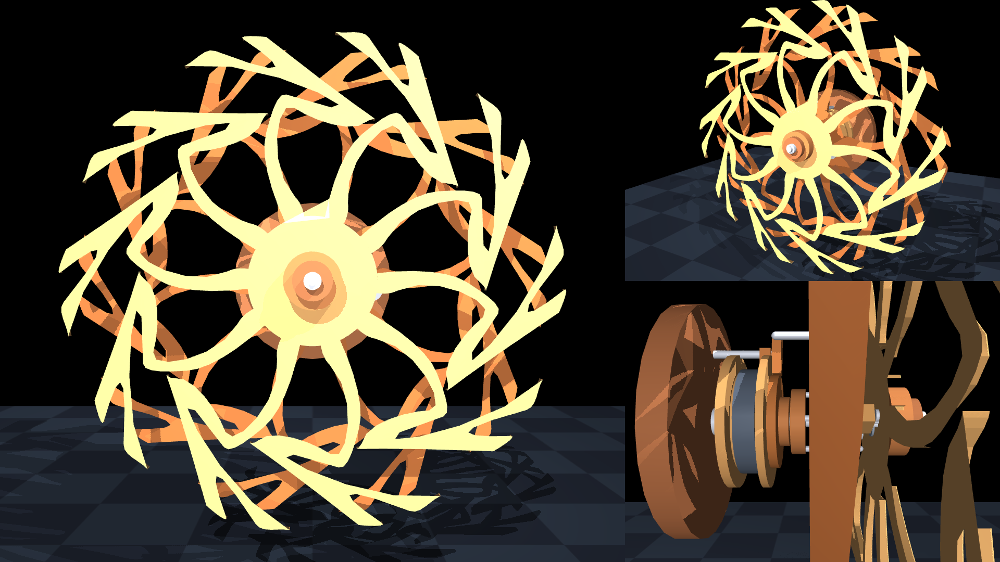
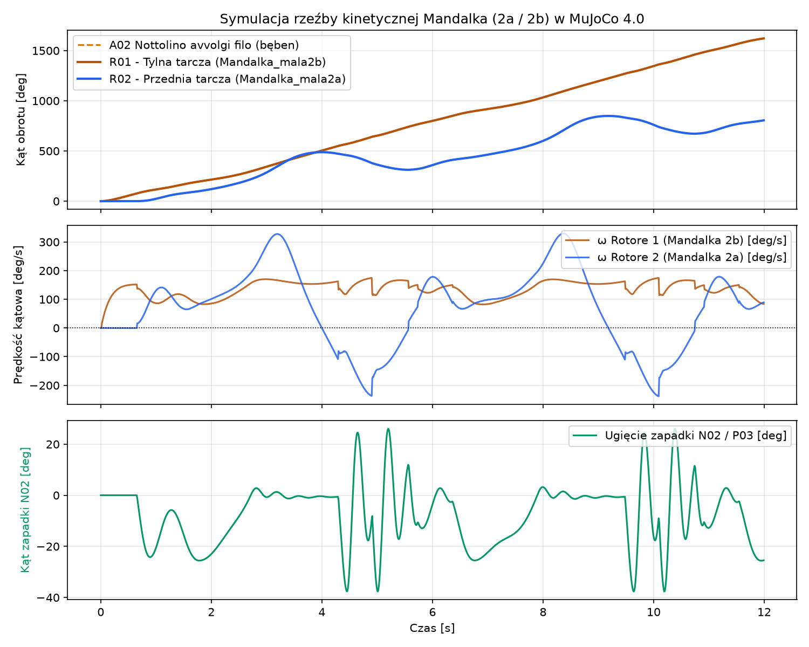

# Kinetic Art MuJoCo Simulation — Mandala Counter-Rotating Sculpture

Physics simulations in **MuJoCo 4** of a coaxial, spring-driven kinetic art sculpture featuring a gravity-balanced escapement mechanism (designed by [**theisolab**](https://www.youtube.com/@theisolab9494)) and counter-rotating **Mandala** rotors (artwork by **Honorata Łukasik**).

## Simulation Video (`mandalka_simulation.mp4`)

> `mandalka_simulation.mp4` (~78 MB Full HD 60 FPS) exceeds GitHub's inline video size limit — watch the full simulation on YouTube or render it locally with `simulate_mandalka.py`:

[](https://youtu.be/M24XzXh13Ds)

- **Watch on YouTube:** [https://youtu.be/M24XzXh13Ds](https://youtu.be/M24XzXh13Ds)

---

## Technical Manual & Mechanism Explanation

The sculpture operates as a coaxial spring/gravity-impulse motor mounted on a single stationary **M8 threaded shaft (`C01`)** anchored to a wall support plate (`R00`). Its architecture is divided into three axial planes (**A – B – C** along the $Y$ axis in the MuJoCo coordinate frame, where $XZ$ is the vertical wall plane and $-Z$ is the direction of gravity):

### 1. Plane `(A)` — Wall Support & Constant-Torque Spool (`R00`, `A01–A03`, `P01`)

| Code | Component | Dimensions / Role in Simulation |
| :--- | :--- | :--- |
| **`R00`** | Wall support disc (*Supporto a parete*) | Stationary wooden base disc ($\varnothing 164\text{ mm} \times 16\text{ mm}$) at $y = 0$. |
| **`C01`–`C05`, `A05`** | M8 threaded central shaft, nuts & washers | Stationary coaxial shaft ($r = 4\text{ mm}$, $L = 175\text{ mm}$) with spacer washers separating the bearing hubs. |
| **`P01`** | Upper stationary stop pin (*Perno metallico*) | Steel pin ($\varnothing 6\text{ mm}$, $L = 60\text{ mm}$) fixed to `R00` at inner radius $r = 49\text{ mm}$ ($z = +0.049\text{ m}$) with upper stationary pawl `A03`. |
| **`A01-1`, `A02`, `A01-2`** | Winding spool assembly (*Nottolino avvolgi filo*) | Rotates on two **608ZZ (`C06`)** ball bearings ($\varnothing 8 \times \varnothing 22 \times 7\text{ mm}$) inside wooden hub `N01`. Driven by a constant-tension spring/cord actuator (`spring_drive_A02`, $\tau = 0.055\text{ N}\cdot\text{m}$). |
| **`A03`** | 12-tooth ratchet star & lower drive lug (*Dente*) | Mounted to the right flange of `A02` at $y = 53.5\text{ mm}$. Its bottom lug extends radially to $r = 64\text{ mm}$ (`contype="1" conaffinity="1"`) to push the drive pin `P02` on Rotor 1. |

### 2. Plane `(B)` — Rear Drive Rotor 1 (`R01`, `Mandalka_mala2b`)

| Code | Component | Dimensions / Role in Simulation |
| :--- | :--- | :--- |
| **`R01`** | Rear Rotor 1 (*Rotore 1*) | Mounted at $y = 83.5\text{ mm}$ on two **608ZZ (`C06`)** bearings housed in wooden hubs **`N01`** ($y = 70\text{ mm}$ and $y = 97\text{ mm}$). Carries the rear Mandala disc (`mandalka_2b.stl`, $\varnothing 440\text{ mm}$). |
| **`P02` (drive)** | Outer drive pin (*Perno metallico su rotore 1*) | Mounted at outer radius $r = 62\text{ mm}$. Driven by the lower lug of `A03` (`contype="1"`). Because $r_{P02} = 62\text{ mm} > r_{P01} = 49\text{ mm}$, `P02` clears the upper stationary pin `P01` during full $360^\circ$ rotations without collision. |
| **`P02` (1–4)** | Four axial escapement pins | Four steel pins ($\varnothing 4\text{ mm}$, $L = 40\text{ mm}$) at radius $r = 20\text{ mm}$ (`contype="2" conaffinity="2"`) protruding into the inter-rotor gap between Plane `(B)` and Plane `(C)`. |

### 3. Plane `(C)` — Front Counter-Rotating Rotor 2 & Escapement (`R02`, `Mandalka_mala2a`, `N02`, `P03`)

| Code | Component | Dimensions / Role in Simulation |
| :--- | :--- | :--- |
| **`N03`** | Spacer sleeve (*Nottolino distanziatore*) | Wooden spacer on the M8 shaft at $y = 112\text{ mm}$ maintaining axial separation between Rotor 1 and Rotor 2. |
| **`R02`** | Front Rotor 2 (*Rotore 2*) | Mounted at $y = 128\text{ mm}$ on two **608ZZ (`C06`)** bearings and front hub cap `N01`. Carries the front Mandala disc (`mandalka_2a.stl`, $\varnothing 440\text{ mm}$). |
| **`contrappeso`** | Eccentric counterweight | Steel mass ($52\text{ g}$) attached on the inner side of `R02` ($z = -52\text{ mm}$), providing gravitational restoring torque. |
| **`N02 / A04`** | Pivoting escapement pawl (*Nottolino*) | Mounted on the back face of `R02` at $(y = 115\text{ mm}, z = +34\text{ mm})$ via a torsion-spring hinge joint (`joint_nottolino_N02`, range $[-65^\circ, +35^\circ]$, stiffness $0.055\text{ N}\cdot\text{m/rad}$). |
| **`P03`** | Pawl catch & guide pins (*Perno metallico*) | Steel pin ($\varnothing 1.5\text{ mm}$, $L = 27\text{ mm}$, `contype="2" conaffinity="2"`) extending downward from `N02` to radius $r \approx 19.5\text{ mm}$, intersecting the circular path of pins `P02` on Rotor 1. |

### How the Counter-Rotating Escapement Works

1. **Lifting Phase:** The constant-torque spool `A02` drives Rotor 1 (`R01`) continuously in one direction via the `A03` $\rightarrow$ `P02` coupling. One of the inner pins `P02` on Rotor 1 catches the pin `P03` on the pawl `N02`, lifting the eccentrically weighted Rotor 2 (`R02`) along with Rotor 1 against gravity.
2. **Release & Impulse Phase:** As Rotor 2 is lifted past the release angle, the contact geometry and gravitational torque cause the spring-loaded pawl `N02` to deflect and slip off the `P02` pin.
3. **Counter-Rotation & Moiré Effect:** Once released, Rotor 2 swings rapidly in the **opposite direction** under the pull of its eccentric counterweight (`contrappeso`), oscillating until the next `P02` pin re-engages `P03`. The superposition of the continuously rotating rear Mandala (`Mandalka_mala2b`) and the oscillating/counter-rotating front Mandala (`Mandalka_mala2a`) produces a rich optical moiré pattern.



---

## Vector PDF to 3D STL Mesh Pipeline (`build_mandalka_model.py`)

The Mandala rotor geometries are generated directly from Honorata Łukasik's vector PDF artwork without external CAD dependencies:

1. **Stream Decompression & Bézier Sampling:** [`extract_pdf_polygon`](scripts/build_mandalka_model.py) decompresses the `FlateDecode` content stream in `documents/Mandalka_mala2a.pdf` (front rotor `R02`) and `documents/Mandalka_mala2b.pdf` (rear rotor `R01`), parses the cubic Bézier (`c`) and move (`m`) operators, centers the geometry at $(164.752, 164.532)\text{ pt}$, and scales the outer radius to $R = 0.220\text{ m}$ ($\varnothing 440\text{ mm}$, 754 boundary vertices).
2. **2D Ear-Clipping Triangulation:** [`ear_clip_triangulate`](scripts/build_mandalka_model.py) enforces counter-clockwise winding and triangulates the non-convex 754-vertex polygon into 752 triangles.
3. **3D Axial Extrusion to Binary STL:** [`write_extruded_stl`](scripts/build_mandalka_model.py) extrudes the triangulated 2D profile along the $Y$ axis to a thickness of $8\text{ mm}$ ($\pm 4\text{ mm}$), generating watertight front/back faces and perimeter side walls in `scripts/meshes/mandalka_2a.stl` and `scripts/meshes/mandalka_2b.stl`.

---

## Repository Structure

```text
.
├── documents/
│   ├── Mandalka_mala2a.pdf        # Front rotor vector artwork (Honorata Łukasik, CC BY 4.0)
│   └── Mandalka_mala2b.pdf        # Rear rotor vector artwork (Honorata Łukasik, CC BY 4.0)
├── scripts/
│   ├── build_mandalka_model.py    # Extracts Bézier paths from PDF -> extruded 3D STL meshes
│   ├── theisolab_mandalka.xml     # MuJoCo 4 MJCF model with Mandala 2a/2b rotor meshes
│   ├── simulate_mandalka.py       # Interactive viewer & headless 16:9 video/plot recorder
│   ├── meshes/
│   │   ├── mandalka_2a.stl        # Extruded 3D mesh for Front Rotor 2 (440 mm diameter)
│   │   └── mandalka_2b.stl        # Extruded 3D mesh for Rear Rotor 1 (440 mm diameter)
│   ├── build_model_xml.py         # Parametric MJCF generator for the base mechanism
│   ├── theisolab_motor.xml        # Base mechanism MJCF model (procedural wave blades)
│   ├── simulate_motor.py          # Simulation script for the base mechanism
│   ├── mandalka_preview.png       # 3-view frame (Front | Isometric 3D | Side A-B-C)
│   └── mandalka_kinematics.png    # Angular position, velocity & pawl deflection plots
├── pyproject.toml                 # Project metadata and dependencies (uv / pip, Python >= 3.11)
├── requirements.txt               # Direct package dependencies
├── uv.lock                        # Reproducible lockfile for uv
└── LICENSE                        # MIT (code) + CC BY 4.0 (Mandala artwork)
```

---

## Installation

Requires **Python $\ge$ 3.11** (required by `mujoco >= 4.0.0`). Works on Linux, Windows, and macOS.

### Using `uv` (recommended)

```bash
uv sync
```

*(If your root partition has limited space, keep the cache and temporary build directories local to the workspace:)*
```bash
UV_CACHE_DIR=.cache TMPDIR=.temp uv sync
```

### Using `pip`

```bash
python3.11 -m venv .venv
source .venv/bin/activate  # On Windows: .venv\Scripts\activate
pip install -e .
```

---

## Usage

### 1. Interactive 3D MuJoCo Viewer (Mandala Sculpture)

```bash
uv run python scripts/simulate_mandalka.py --viewer
```
*(Or via the installed entry point: `uv run simulate-mandalka --viewer`)*

### 2. Render `mandalka_simulation.mp4` and Kinematics Plots Headlessly

```bash
uv run python scripts/simulate_mandalka.py --duration 10
```

> **Linux headless note:** If running without an X11/Wayland display server, set `MUJOCO_GL=egl` (or `osmesa`):
> ```bash
> MUJOCO_GL=egl uv run python scripts/simulate_mandalka.py --duration 10
> ```

### 3. Rebuild 3D STL Meshes from the Vector PDFs

```bash
uv run python scripts/build_mandalka_model.py
```

### 4. Base Mechanism Simulation (Procedural Wave Blades)

```bash
uv run python scripts/build_model_xml.py
uv run python scripts/simulate_motor.py --viewer
```

---

## References & Source Links

- **Mechanism Design by theisolab:**
  - YouTube Channel: [@theisolab9494](https://www.youtube.com/@theisolab9494)
  - Motor Cross-Section & Escapement Video: [Come costruire una scultura cinetica in legno - Il Motore (`pAZqkuIwe5g`)](https://www.youtube.com/watch?v=pAZqkuIwe5g)
  - Prototype Video: [Scultura cinetica in legno (`8i7NJayHuxc`)](https://www.youtube.com/watch?v=8i7NJayHuxc)
  - Technical Articles: [Progetto di scultura cinetica in legno](https://www.theisolab.it/it/progetti/kinetic/progetto-di-scultura-cinetica-in-legno.html) | [Analisi progetto](https://www.theisolab.it/it/progetti/kinetic/progetto-scultura-cinetica-in-legno.html) | [The Sea](https://www.theisolab.it/it/progetti/kinetic/progetto-di-scultura-cinetica-the-sea.html)

---

## Credits & Licenses

- **Code, Simulation Scripts & MuJoCo Models ([MIT License](LICENSE)):**  
  Copyright (c) 2026 **Igor Zubrycki** and **Honorata Łukasik**.
- **Mandala Artwork & 3D Rotor Meshes ([Creative Commons CC BY 4.0](https://creativecommons.org/licenses/by/4.0/)):**  
  Copyright (c) 2026 **Honorata Łukasik** (`documents/Mandalka_mala2a.pdf`, `documents/Mandalka_mala2b.pdf`, `scripts/meshes/mandalka_2a.stl`, `scripts/meshes/mandalka_2b.stl`, `scripts/mandalka_preview.png`).
- **Kinetic Mechanism Design:**  
  Coaxial counter-rotating motor and escapement mechanism designed by **theisolab** ([YouTube `@theisolab9494`](https://www.youtube.com/@theisolab9494) / [theisolab.it](https://www.theisolab.it)).
